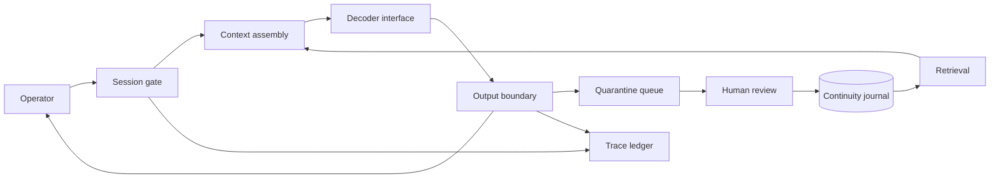

# System architecture

The design separates language generation, remembered evidence, and host
authority. No subsystem may silently promote an assertion from one plane
to another. A remembered instruction remains a remembered instruction.

## Execution paths

The local path reads fixed transcript records. The research path is
specified here but requires the separately held parameter bundle and an
approved inference adapter. The two paths share envelopes and evaluation
contracts; they do not share claims about model capability.

## Failure domains

Decoder failure closes the session. Retrieval failure permits an empty
evidence context and records a degraded turn. Journal failure disables
writes. Observer failure prevents promotion to a new research run.

## Ownership

Runtime owns sequencing. Memory owns evidence lineage. Evaluation owns
measurement definitions. Operations owns the authority to resume.
